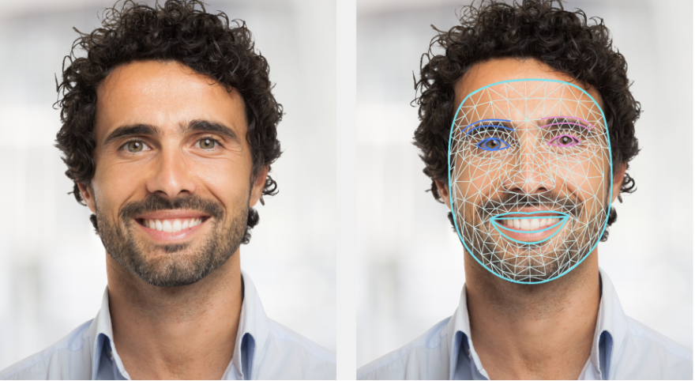
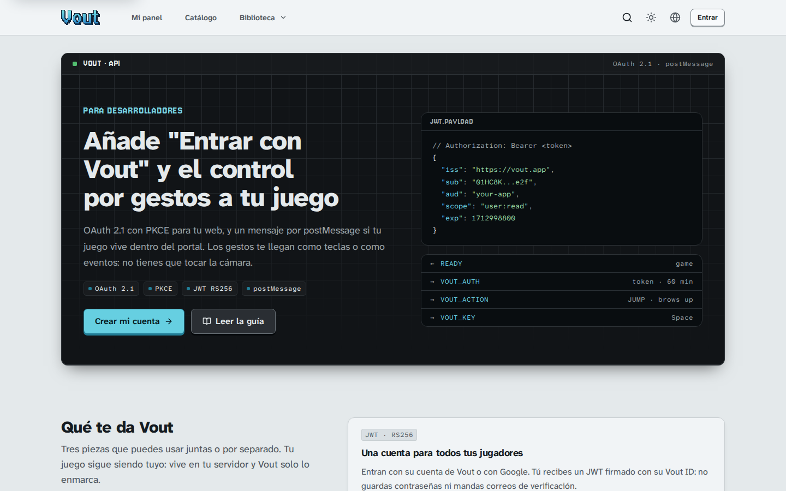
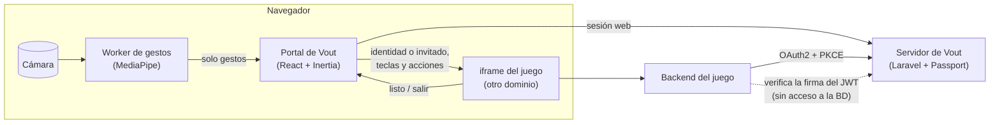

# Vout

**Un portal de juegos con su propio sistema de identidad y control por gestos en el navegador.** Una sola cuenta para todos los juegos del ecosistema, y una webcam que hace de mando.

[Read in English](README.md)

<p align="center">
  
  <br>
  <sub>Lo que ve el motor de gestos: los puntos de la cara que MediaPipe detecta en cada fotograma de la cámara. Imagen: documentación de Google MediaPipe.</sub>
</p>

## Dos pilares

**1. Un ecosistema de identidad para juegos.** El jugador crea una cuenta de Vout y la usa en todos los juegos, tanto si el juego corre dentro del portal como en su propia web. Detrás hay un servidor OAuth2 basado en estándares, con tokens firmados que cada juego verifica por su cuenta.

**2. Control por gestos en mejora continua.** Enciendes la cámara y tu cara pasa a ser un mando. Cada juego decide qué hace cada gesto. En uno de plataformas, levantar las cejas puede ser saltar. En uno de puzles, asentir puede confirmar la jugada, y con el seguimiento de la cabeza puedes llevar un cursor. La detección ocurre entera en el navegador, la imagen nunca sale del dispositivo del jugador y el motor mejora con cada versión.

## ¿Por qué un sistema de identidad propio y no simplemente "Entrar con Google"?

Es una pregunta lógica. Entrar con Google funciona muy bien en una web suelta. El problema aparece cuando los juegos conviven en un portal.

Vout nació de ese problema. Daino, uno de mis juegos, tiene su propia base de datos: se puede jugar sin cuenta o entrar para guardar el récord. Cuando quise meter Daino en el portal de Vout, la experiencia se rompía: entrar en el portal, abrir el juego y volver a entrar dentro del juego. Eran dos inicios de sesión, y dos cuentas que podían acabar con dos correos distintos.

El sistema de identidad de Vout lo resuelve:

- **Sin segundo inicio de sesión.** Cuando un jugador con sesión abre un juego del portal, el portal le pasa su identidad al juego de forma segura y el juego le reconoce al instante. El login de Google no puede hacer esto dentro de un juego integrado: no se deja cargar en un iframe, y ahí el navegador bloquea las cookies que necesitaría.
- **Una cuenta, la misma en todas partes.** El jugador usa la misma cuenta en el portal, dentro de cada juego y en la web propia de cada juego ("Entrar con Vout"). El desarrollador recibe un único identificador estable para ese jugador en todos los casos, así que el progreso nunca se parte en dos.
- **Google sigue ahí.** El jugador puede crear su cuenta de Vout con Google, así que conserva el acceso con un clic que ya conoce. El desarrollador integra una sola vez, con Vout.
- **El jugador decide.** Cada juego ve solo lo que el jugador aprobó, y puede retirarlo cuando quiera. Un juego que no necesita cuentas lo declara, y nunca recibe la identidad de nadie.
- **Abierto a otros desarrolladores.** Cualquiera puede registrar su juego desde el portal de desarrolladores. Los juegos sin cuenta funcionan tal cual. Los que tienen cuentas obtienen el inicio de sesión gratis, y sus jugadores no tienen que volver a entrar dentro del portal.

## Pruébalo

1. Abre un juego cuya ficha diga que se puede jugar sin cuenta. No hace falta registrarse.
2. Pulsa **"Control facial"** y después **"Probar ahora"**. El navegador te pedirá permiso para la cámara.
3. Levanta las cejas o gira la cabeza. Con los controles por defecto, el juego recibe cada gesto como una tecla.

Si entras con tu cuenta, los juegos que usan cuentas te reconocen, y se guardan tus ajustes de gestos y tu sensibilidad.

## Cómo funciona

### Identidad: un servidor OAuth2, no solo un formulario de entrada

Vout está hecho sobre Laravel Passport y sigue los mismos estándares que los grandes proveedores de identidad:

- **Authorization Code con PKCE** para los juegos que hacen entrar al jugador desde su propia web.
- **JWT firmados con RS256**, con un conjunto de claves públicas y descubrimiento al estilo OpenID. Los juegos verifican los tokens por su cuenta (firma, emisor, audiencia, caducidad) y nunca necesitan acceso a la base de datos de Vout. Así cada juego queda desacoplado y los datos de los jugadores se quedan donde están.
- **Consentimiento por juego**, con permisos concretos y revocable.
- Doble factor, entrada con Google y verificación del correo para las propias cuentas.

### Juegos en un iframe, identidad por `postMessage`

Dentro del portal, cada juego corre en un iframe en su propio dominio. En lugar de cookies, el portal y el juego usan un apretón de manos:

1. El juego avisa de que está listo (`READY`).
2. El portal comprueba que el mensaje viene de verdad del origen registrado de ese juego y del iframe que él mismo creó.
3. El portal responde con un token de vida corta (`VOUT_AUTH`) o, si no hay identidad que compartir, con un saludo de invitado (`VOUT_GUEST`).
4. Antes de que el token caduque, el portal envía uno nuevo. Cuando la sesión termina, se le dice al juego por qué.

Los tokens nunca viajan en una URL, y el portal solo envía mensajes al origen que ha verificado. Cada juego declara si necesita cuenta (sin cuenta, opcional u obligatoria), y el portal lo hace cumplir.

### El motor de gestos

- **Visión en el propio dispositivo.** [MediaPipe Face Landmarker](https://ai.google.dev/edge/mediapipe/solutions/vision/face_landmarker), de Google, corre en un **Web Worker propio**, así que detectar gestos nunca le quita tiempo al dibujado del juego. Vout sirve él mismo el modelo y el runtime, sin CDN de terceros.
- **Medido, no supuesto.** El motor mide sus propios tiempos en cada etapa. En un portátil de gama media con GPU integrada (Intel UHD 620), la inferencia tarda unos **40 ms** (mediana) y el camino completo del fotograma de la cámara al gesto detectado unos **75 ms**, sin que se acumulen fotogramas.
- **Calibrado para cada jugador.** Los gestos se miden contra la cara neutra de cada jugador, con sensibilidad ajustable. Un gesto mantenido funciona como una tecla mantenida.
- **Configurable por jugador y por juego.** El jugador elige qué hace cada gesto (una tecla, un clic o un evento del juego), y los juegos pueden sugerir sus propios controles.
- **Un SDK pequeño para desarrolladores.** El navegador no deja que una web escriba en la página de otra. El SDK de Vout, sin dependencias, corre dentro del juego y convierte los mensajes del portal en eventos de teclado y ratón reales, así que los controles que ya tenía el juego funcionan sin cambios.

**Lo siguiente en gestos:** navegar por todo el portal sin manos, más gestos y, más adelante, seguimiento de manos y cuerpo. El objetivo es que el control por gestos sea una alternativa real para quien tiene dificultades con un teclado o un mando. Hoy ya ayuda, y sigue mejorando.

## Seguridad y privacidad desde el diseño

- **La imagen de la cámara se queda en el dispositivo.** Del worker de visión solo sale la acción detectada. Vout guarda ajustes numéricos como la sensibilidad, nunca imágenes ni datos de la cara. Sigue las pautas de la AEPD.
- **La cámara solo se enciende tras una acción explícita.** Se pausa con la pestaña oculta y se apaga al minuto.
- **Mínimo privilegio:** tokens de vida corta, permisos por scope, consentimiento por juego, comprobación estricta de orígenes, protección CSRF y límites de peticiones en los puntos sensibles.
- **Las cookies justas:** solo las que el sitio necesita para funcionar, más una de preferencia opcional. Sin rastreadores publicitarios ni analítica de terceros.

## Accesibilidad

- Auditorías automáticas con **axe** en las páginas clave, en claro y en oscuro.
- Un test comprueba el **contraste de cada color** del tema según WCAG AA.
- La interfaz usa **Atkinson Hyperlegible**, una letra que el Braille Institute diseñó para personas con baja visión. Se sirve desde el propio Vout.
- Todo funciona con teclado, con el foco siempre visible, y la interfaz está en español y en inglés.

## Calidad

- **Más de 800 tests de PHP:** unitarios, de integración y **en navegador real** (Pest 4 + Playwright). Los de navegador juegan a juegos de prueba en otro origen, comprueban el apretón de manos completo y pasan el modelo de visión real por una cámara sintética.
- **Unos 380 tests de JavaScript** del motor de gestos, del clasificador (con grabaciones reales de gestos) y del sistema de diseño.
- El lint, el formato y todos los tests se ejecutan en GitHub Actions con cada push a `main`.

## Para desarrolladores



Cualquier juego web que funcione dentro de un iframe puede entrar en el catálogo, y el registro lo haces tú desde tu panel. La [guía de integración](docs/integration-guide.md) es la referencia completa para registrar una app, "Entrar con Vout", verificar los tokens, el protocolo del iframe y el SDK. Está escrita para que la sigas de principio a fin, tú o tu agente de IA. Para un juego dentro del portal, lo más rápido es:

```html
<script src="https://TU-DOMINIO-DE-VOUT/sdk/vout-game.js"></script>
<script>
    VoutGame.connect({
        portalOrigin: 'https://TU-DOMINIO-DE-VOUT',
        onAuth(session) { /* jugador con cuenta: manda session.token a tu backend */ },
        onGuest() { /* juega sin cuenta */ },
    });
</script>
```

## Arquitectura



## Tecnologías

| Capa | Tecnología |
| :--- | :--- |
| Backend | PHP 8.5, Laravel 13, Laravel Passport (OAuth2), Fortify, Socialite, MariaDB |
| Frontend | React 19, Inertia.js 2, TypeScript, Tailwind CSS 4, Wayfinder (rutas con tipos) |
| Visión artificial | MediaPipe Tasks Vision (Face Landmarker) en un Web Worker |
| Tests | Pest 4 (unitarios, de integración y de navegador con Playwright), Bun test |
| Herramientas | Docker (Laravel Sail), Bun, ESLint, Prettier, Pint, GitHub Actions |

## Ejecutarlo en local

Necesitas Docker. El proyecto corre dentro de [Laravel Sail](https://laravel.com/docs/sail).

```bash
git clone https://github.com/OliverMp28/vout.git && cd vout
cp .env.example .env
docker run --rm -u "$(id -u):$(id -g)" -v "$(pwd):/var/www/html" -w /var/www/html laravelsail/php84-composer:latest composer install --ignore-platform-reqs
vendor/bin/sail up -d
vendor/bin/sail artisan key:generate
vendor/bin/sail artisan passport:keys
vendor/bin/sail artisan migrate --seed
vendor/bin/sail bun install
vendor/bin/sail bun run build
```

Después abre <http://localhost> y crea una cuenta. Entrar con Google es opcional y necesita tus propias credenciales OAuth en `.env`. Para desarrollar, `vendor/bin/sail bun run dev` recarga los cambios al guardar.

Para pasar los tests:

```bash
vendor/bin/sail artisan test --compact
vendor/bin/sail bun run test:js
```

## Autor

Diseñado y desarrollado por [Oliver](https://github.com/OliverMp28): producto, backend, frontend, visión artificial y tests.
