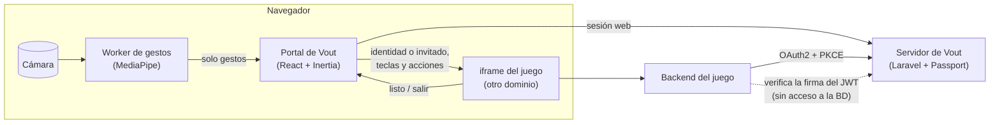

# Vout

**Una sola cuenta para toda una familia de juegos de navegador, y una forma de jugarlos con la cara.**

[Read in English](README.md)


## La idea

Casi todos los juegos web dan por hecho que tienes dos manos y un teclado. Mucha gente no los tiene: personas con movilidad reducida, personas recuperándose de una lesión o que no pueden sujetar un mando mucho rato.

Vout les deja jugar igualmente. Enciendes la webcam y tu cara pasa a ser el mando. Levantas las cejas para saltar, abres la boca para agacharte y giras la cabeza para moverte. El juego recibe pulsaciones de teclado normales, así que ni siquiera necesita saber que hay una cámara de por medio.

Alrededor de eso, Vout resuelve un segundo problema que tiene cualquier estudio pequeño: las cuentas. En vez de que cada juego monte su propio registro, recuperación de contraseña y verificación de correo, el jugador crea **una cuenta de Vout** y la usa en todos, como harías con "Entrar con Google".

## Lo más destacado

- **Jugar sin manos en el navegador.** Seguimiento de la cara en tiempo real, sin instalar nada ni plugins, y la imagen de la cámara nunca sale del dispositivo del jugador.
- **Un proveedor de identidad de verdad.** Es un servidor OAuth2 basado en estándares, con tokens firmados que cualquier juego puede verificar por su cuenta.
- **Juegos de cualquier sitio.** Los juegos de terceros siguen en sus propios dominios. Vout los integra y habla con ellos con un protocolo pequeño y documentado.
- **Hecho para que se confíe en él.** La accesibilidad se comprueba con tests automáticos, los datos personales se reducen al mínimo y todas las capas tienen tests, de los unitarios a los de navegador real.

## Pruébalo

1. Abre un juego cuya ficha diga que se puede jugar sin cuenta. No hace falta registrarse.
2. Pulsa **"Control facial"** y después **"Probar ahora"**. El navegador te pedirá permiso para la cámara.
3. Mira a la cámara y levanta las cejas. El juego reacciona como si hubieras pulsado una tecla.

Si entras con tu cuenta, el juego te reconoce y guarda tu progreso. Tus ajustes de gestos y la sensibilidad se guardan en tu cuenta.

## Cómo funciona

### Identidad: un servidor OAuth2, no solo un formulario de entrada

Vout está hecho sobre Laravel Passport y sigue los mismos estándares que los grandes proveedores de identidad:

- **Authorization Code con PKCE** para los juegos que hacen entrar al jugador desde su propia web ("Entrar con Vout").
- **JWT firmados con RS256**, con un conjunto de claves públicas y descubrimiento al estilo OpenID. Los juegos verifican los tokens por su cuenta (firma, emisor, audiencia, caducidad) y nunca necesitan acceso a la base de datos de Vout. Así los juegos quedan desacoplados y los datos de Vout se quedan donde están.
- **Consentimiento con permisos concretos y revocable.** Un juego solo recibe lo que el jugador aprobó, y el jugador puede retirarlo cuando quiera desde sus ajustes.
- Doble factor, entrada con Google y verificación del correo para las propias cuentas.

### Juegos en un iframe, identidad por `postMessage`

Dentro del portal, los juegos corren en un iframe en su propio dominio. Los navegadores bloquean cada vez más las cookies de terceros ahí, así que lo habitual ("el juego lee su propia sesión") no funciona. Vout usa en su lugar un apretón de manos:

1. El juego avisa de que está listo (`READY`).
2. El portal comprueba que el mensaje viene de verdad del origen registrado de ese juego y del iframe que él mismo creó.
3. El portal responde con un token de vida corta (`VOUT_AUTH`) o, si el jugador no tiene cuenta, con un saludo de invitado (`VOUT_GUEST`).
4. Antes de que el token caduque, el portal envía uno nuevo. Cuando la sesión termina, se le dice al juego por qué.

Los tokens nunca viajan en una URL, y el portal solo envía mensajes al origen que ha verificado.

Cada juego declara además cuánto necesita saber del jugador:

- **Sin cuenta:** el juego nunca recibe la identidad del jugador.
- **Cuenta opcional:** cualquiera juega, y a quien ha entrado se le reconoce.
- **Cuenta obligatoria.**

El portal hace cumplir lo que el juego declara, así que un juego que no necesita datos personales nunca los recibe.

### El motor de gestos

- **Visión en el propio dispositivo.** [MediaPipe Face Landmarker](https://ai.google.dev/edge/mediapipe/solutions/vision/face_landmarker), de Google, corre en un **Web Worker propio**, así que detectar gestos nunca le quita tiempo al dibujado del juego. Vout sirve él mismo el modelo y el runtime, sin CDN de terceros.
- **Medido, no supuesto.** El motor mide sus propios tiempos en cada etapa. En un portátil de gama media con GPU integrada (Intel UHD 620), la inferencia tarda unos **40 ms** (mediana) y el camino completo del fotograma de la cámara al gesto detectado unos **75 ms**, sin que se acumulen fotogramas.
- **Calibrado para cada jugador.** Los gestos se miden contra la cara neutra de cada jugador, con sensibilidad ajustable, porque las caras y la movilidad varían mucho. Un gesto mantenido funciona como una tecla mantenida.
- **Un SDK pequeño para desarrolladores.** Por seguridad, los navegadores no dejan que una web escriba en la página de otra. El SDK de Vout, sin dependencias, corre dentro del juego y convierte los mensajes del portal en eventos de teclado y ratón reales. Los controles que ya tenía el juego funcionan sin cambios, e integrarlo son dos líneas.

## Seguridad y privacidad desde el diseño

- **La imagen de la cámara se queda en el dispositivo.** Del worker de visión solo sale la acción detectada (por ejemplo, "saltar"). Vout guarda ajustes numéricos como la sensibilidad, nunca imágenes ni datos de la cara. Sigue las pautas de la AEPD.
- **La cámara solo se enciende tras una acción explícita.** Se pausa con la pestaña oculta y se apaga al minuto.
- **Mínimo privilegio en todo:** tokens de vida corta, permisos por scope, consentimiento por juego, comprobación estricta de orígenes, protección CSRF y límites de peticiones en los puntos sensibles.
- **Las cookies justas:** solo las que el sitio necesita para funcionar, más una de preferencia opcional. Sin rastreadores publicitarios ni analítica de terceros.

## Accesibilidad

Aquí la accesibilidad es un requisito, no un extra:

- Auditorías automáticas con **axe** en las páginas clave, en claro y en oscuro.
- Un test comprueba el **contraste de cada color** del tema según WCAG AA.
- La interfaz usa **Atkinson Hyperlegible**, una letra que el Braille Institute diseñó para personas con baja visión. Se sirve desde Vout, sin peticiones a servidores de fuentes externos.
- Todo funciona con teclado y con el foco siempre visible, y la interfaz está en español y en inglés.

## Calidad

- **Más de 800 tests de PHP:** unitarios, de integración y **en navegador real** (Pest 4 + Playwright). Los de navegador juegan a juegos de prueba en otro origen, comprueban el apretón de manos completo y pasan el modelo de visión real por una cámara sintética.
- **Unos 380 tests de JavaScript** del motor de gestos, del clasificador (con grabaciones reales de gestos) y del sistema de diseño.
- El lint, el formato y todos los tests se ejecutan en GitHub Actions con cada push a `main`.


## Arquitectura



## Tecnologías

| Capa | Tecnología |
| :--- | :--- |
| Backend | PHP 8.5, Laravel 13, Laravel Passport (OAuth2), Fortify, Socialite, MariaDB |
| Frontend | React 19, Inertia.js 2, TypeScript, Tailwind CSS 4, Wayfinder (rutas con tipos) |
| Visión artificial | MediaPipe Tasks Vision (Face Landmarker) en un Web Worker |
| Tests | Pest 4 (unitarios, de integración y de navegador con Playwright), Bun test |
| Herramientas | Docker (Laravel Sail), Bun, ESLint, Prettier, Pint, GitHub Actions |

## Ejecutarlo en local

Necesitas Docker. El proyecto corre dentro de [Laravel Sail](https://laravel.com/docs/sail).

```bash
git clone https://github.com/OliverMp28/vout.git && cd vout
cp .env.example .env
docker run --rm -u "$(id -u):$(id -g)" -v "$(pwd):/var/www/html" -w /var/www/html laravelsail/php84-composer:latest composer install --ignore-platform-reqs
vendor/bin/sail up -d
vendor/bin/sail artisan key:generate
vendor/bin/sail artisan passport:keys
vendor/bin/sail artisan migrate --seed
vendor/bin/sail bun install
vendor/bin/sail bun run build
```

Después abre <http://localhost> y crea una cuenta. Entrar con Google es opcional y necesita tus propias credenciales OAuth en `.env`. Para desarrollar, `vendor/bin/sail bun run dev` recarga los cambios al guardar.

Para pasar los tests:

```bash
vendor/bin/sail artisan test --compact
vendor/bin/sail bun run test:js
```

## Añadir un juego

Cualquier juego web que funcione dentro de un iframe puede entrar en el catálogo. La [guía de integración](docs/integration-guide.md) explica "Entrar con Vout", cómo verificar los tokens, el protocolo del iframe y el SDK. Para empezar rápido:

```html
<script src="https://TU-DOMINIO-DE-VOUT/sdk/vout-game.js"></script>
<script>
    VoutGame.connect({
        portalOrigin: 'https://TU-DOMINIO-DE-VOUT',
        onAuth(session) { /* jugador con cuenta: manda session.token a tu backend */ },
        onGuest() { /* juega sin cuenta */ },
    });
</script>
```

**Daino**, un proyecto aparte, es un juego hecho así. Usa Vout para que el jugador entre, tanto en su propia web como dentro del portal.

## Autor

Diseñado y desarrollado por [Oliver](https://github.com/OliverMp28): producto, backend, frontend, visión artificial y tests.
