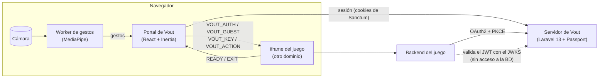

# Vout

**Una sola cuenta para una familia de juegos de navegador, y una forma de jugarlos con la cara.**

[Read in English](README.md)


Vout son tres cosas que funcionan juntas:

- **Un proveedor de identidad.** Creas una cuenta de Vout y la usas para entrar en todos los juegos del ecosistema. Vout es un servidor OAuth2 completo (Authorization Code + PKCE) que emite JWT firmados, así que cada juego comprueba quién eres sin tocar nunca la base de datos de Vout.
- **Un portal de juegos.** Un catálogo de juegos de navegador que abres y juegas al momento, con favoritos, biblioteca y "seguir jugando".
- **Control sin manos.** Enciendes la cámara y tu cara pasa a ser el mando: levantas las cejas para saltar, abres la boca para agacharte, giras la cabeza para moverte o para llevar un cursor. La detección ocurre entera en tu navegador. La imagen de la cámara nunca sale de tu equipo.

El control sin manos es la razón de ser del proyecto. Mucha gente no puede usar con comodidad un teclado o un mando, y la mayoría de los juegos web no le dan otra opción.

## Pruébalo en 30 segundos

1. Abre un juego cuya ficha diga que se puede jugar sin cuenta. No hace falta registrarse.
2. Pulsa **"Control facial"** y después **"Probar ahora"**. El navegador te pedirá permiso para la cámara.
3. Mira a la cámara y levanta las cejas. El juego lo recibe como una tecla.

Si entras con tu cuenta, el juego te reconoce y guarda tu progreso. También se guardan tus controles y la sensibilidad.

## Lo interesante por dentro

**Proveedor de identidad OAuth2 al estilo OpenID** (Laravel Passport)

- Authorization Code con PKCE para los juegos externos, JWT firmados con RS256 y `kid`, endpoint JWKS público y descubrimiento en `/.well-known/openid-configuration`.
- Los juegos validan los tokens sin estado (firma, `iss`, `aud`, `exp`). Nunca consultan la base de datos de Vout.
- Consentimiento por usuario, que puede revisar y revocar, con scopes (`user:read`, `user:email`, `games:read`, `games:write`).
- Doble factor, entrada con Google y verificación del correo.

**Identidad segura dentro de un iframe**

Los juegos están en sus propios dominios dentro de un iframe, y ahí los navegadores bloquean cada vez más las cookies de terceros. El portal y el juego hablan por `postMessage` (`READY` → `VOUT_AUTH` o `VOUT_GUEST`):

- Los tokens nunca viajan en una URL.
- Cada mensaje se comprueba contra los orígenes registrados del juego, y el portal solo envía al origen validado (nunca a `'*'`).
- El portal renueva el token del juego antes de que caduque y le avisa cuando la sesión termina (`signed_out`, `revoked`, `unavailable`).
- Cada juego declara si necesita cuenta: **sin cuenta** (nunca recibe la identidad del jugador), **opcional** u **obligatoria**.

**Un motor de gestos que va al ritmo del juego**

- [MediaPipe Face Landmarker](https://ai.google.dev/edge/mediapipe/solutions/vision/face_landmarker) corre en un Web Worker propio, así que la detección nunca bloquea el dibujado del juego. El modelo y los WASM los sirve el propio Vout, sin CDN de terceros.
- Medido en un portátil de gama media (Chrome, GPU integrada Intel UHD 620): inferencia p50 ≈ 40 ms, del fotograma de la cámara al resultado ≈ 75 ms, unos 23 fotogramas analizados por segundo de una cámara a 30 fps, y sin cola de fotogramas.
- Los gestos se clasifican contra una cara neutra calibrada para cada jugador, con sensibilidad ajustable. Un gesto mantenido es una tecla mantenida.
- Un juego en otro dominio no puede recibir eventos de teclado sintéticos del portal, así que Vout trae un **SDK pequeño y sin dependencias** (`public/sdk/vout-game.js`) que convierte los mensajes de Vout en eventos `keydown`/`click` reales. Los controles de teclado de siempre del juego funcionan sin cambios.

**Accesibilidad y privacidad como requisitos**

- Comprobación automática de accesibilidad (axe) en las páginas clave en claro y en oscuro, y un test que mide el contraste de cada color del tema (WCAG AA).
- La letra [Atkinson Hyperlegible](https://www.brailleinstitute.org/freefont/), diseñada por el Braille Institute para personas con baja visión, servida desde el propio Vout.
- La cámara solo se enciende tras una acción explícita, se pausa con la pestaña oculta y se apaga al minuto. Solo se guardan ajustes numéricos, nunca imágenes ni datos de la cara, siguiendo las pautas de la AEPD.
- Toda la interfaz está en español y en inglés.

## Arquitectura



## Tecnologías

| Capa | Tecnología |
| :--- | :--- |
| Backend | PHP 8.5, Laravel 13, Laravel Passport (OAuth2), Fortify, Socialite, MariaDB |
| Frontend | React 19, Inertia.js 2, TypeScript, Tailwind CSS 4, Wayfinder (rutas tipadas) |
| Visión artificial | MediaPipe Tasks Vision (Face Landmarker) en un Web Worker |
| Tests | Pest 4 (unitarios, de integración y de navegador con Playwright), Bun test |
| Herramientas | Laravel Sail (Docker), Bun, ESLint, Prettier, Pint, GitHub Actions |

## Ejecutarlo en local

Necesitas Docker. El proyecto corre dentro de [Laravel Sail](https://laravel.com/docs/sail).

```bash
git clone https://github.com/OliverMp28/vout.git && cd vout
cp .env.example .env
docker run --rm -u "$(id -u):$(id -g)" -v "$(pwd):/var/www/html" -w /var/www/html laravelsail/php84-composer:latest composer install --ignore-platform-reqs
vendor/bin/sail up -d
vendor/bin/sail artisan key:generate
vendor/bin/sail artisan passport:keys
vendor/bin/sail artisan migrate --seed
vendor/bin/sail bun install
vendor/bin/sail bun run build
```

Abre <http://localhost> y entra con `test@example.com` / `password`. Para entrar con Google hacen falta `GOOGLE_CLIENT_ID` y `GOOGLE_CLIENT_SECRET` en `.env`.

Para desarrollar, `vendor/bin/sail bun run dev` recarga los cambios al momento.

## Tests

```bash
vendor/bin/sail artisan test --compact   # PHP: unitarios, de integración y de navegador
vendor/bin/sail bun run test:js          # motor de gestos y diseño
vendor/bin/sail bun run lint:check && vendor/bin/sail bun run format:check
```

Los tests de navegador usan un Chromium real: juegan a juegos de prueba en otro origen, comprueban el handshake completo y pasan MediaPipe por una cámara sintética.

## Añadir un juego

Cualquier juego web que funcione dentro de un iframe puede entrar en el catálogo. La [guía de integración](docs/integration-guide.md) explica cómo registrar una app, el botón "Entrar con Vout", cómo validar los tokens, el protocolo del iframe y el SDK. Lo más rápido son dos líneas:

```html
<script src="https://TU-VOUT/sdk/vout-game.js"></script>
<script>
    VoutGame.connect({ portalOrigin: 'https://TU-VOUT', onAuth(session) {}, onGuest() {} });
</script>
```

Daino, un proyecto aparte, es un juego que usa Vout como proveedor de identidad, tanto en su propia web como dentro del portal.

## Autor

Hecho por [Oliver](https://github.com/OliverMp28).
