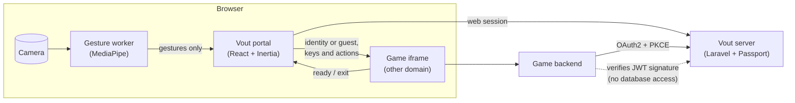

# Vout

**A game portal with its own identity system and gesture control in the browser.** One account for every game in the ecosystem, and a webcam that works as a controller.

[Leer en español](README.es.md)

<p align="center">
  
  <br>
  <sub>What the gesture engine sees: the face landmarks that MediaPipe detects in every camera frame. Image: Google MediaPipe documentation.</sub>
</p>

## Two pillars

**1. An identity ecosystem for games.** Players create one Vout account and use it in every game, whether the game runs inside the portal or on its own website. Behind it is a standards-based OAuth2 server with signed tokens that each game verifies on its own.

**2. Gesture control that keeps improving.** Turn on your camera and your face becomes a controller. Each game decides what every gesture does. In a platformer, raising your eyebrows might be a jump. In a puzzle, a nod might confirm your move, and with head tracking you can steer a cursor. Detection runs entirely in the browser, the image never leaves the player's device, and the engine improves with every release.

## Why its own identity system and not just "Sign in with Google"?

It's a fair question. Google sign-in is great on a standalone website. The problem shows up when games live together in a portal.

Vout started with that exact problem. Daino, one of my games, has its own database: you can play without an account or sign in to keep your high score. When I wanted Daino inside the Vout portal, the experience broke: sign in to the portal, open the game and sign in again inside it. That's two logins, and two accounts that could end up under two different emails.

Vout's identity system solves it:

- **No second login.** When a signed-in player opens a game in the portal, the portal hands the game their identity securely and the game recognizes them instantly. Google's login can't do this inside an embedded game: it refuses to load in an iframe, and browsers block the cookies it would need there.
- **One account, the same everywhere.** The player uses the same account in the portal, inside every game and on each game's own website ("Sign in with Vout"). The developer gets one stable identifier for that player in every case, so progress is never split.
- **Google is still there.** Players can create their Vout account with Google, so they keep the one-click sign-in they already know. The developer integrates once, with Vout.
- **The player stays in control.** Each game sees only what the player approved, and the player can withdraw that at any time. A game that doesn't need accounts can declare it, and it never receives anyone's identity.
- **It's open to other developers.** Anyone can register a game from the developer portal. Games without accounts just work. Games with accounts get sign-in for free, and their players don't have to sign in again inside the portal.

## Try it

1. Open a game whose page says you can play without an account. You don't need to sign up.
2. Press **"Face control"** and then **"Try it now"**. Your browser asks for camera access.
3. Raise your eyebrows or turn your head. With the default controls, the game receives each gesture as a key press.

If you sign in, games that use accounts recognize you, and your gesture settings and sensitivity are saved.

## How it works

### Identity: an OAuth2 server, not just a login form

Vout is built on Laravel Passport and follows the same standards as the big identity providers:

- **Authorization Code with PKCE** for games that sign players in on their own site.
- **RS256-signed JWTs** with a public key set and OpenID-style discovery. Games verify tokens themselves (signature, issuer, audience, expiry) and never need access to Vout's database. This keeps each game decoupled and keeps player data where it is.
- **Scoped, revocable consent** per game.
- Two-factor authentication, Google sign-in and email verification for the accounts themselves.

### Games in an iframe, identity over `postMessage`

Inside the portal, each game runs in an iframe on its own domain. Instead of cookies, the portal and the game use a handshake:

1. The game says it's ready (`READY`).
2. The portal checks that the message really comes from that game's registered origin and from the iframe it created.
3. The portal replies with a short-lived token (`VOUT_AUTH`) or, if there is no identity to share, a guest greeting (`VOUT_GUEST`).
4. Before the token expires, the portal sends a fresh one. When the session ends, the game is told why.

Tokens never travel in a URL, and the portal only sends messages to the origin it verified. Each game declares whether it needs an account (no account, optional or required), and the portal enforces it.

### The gesture engine

- **On-device vision.** Google's [MediaPipe Face Landmarker](https://ai.google.dev/edge/mediapipe/solutions/vision/face_landmarker) runs in a **dedicated Web Worker**, so detecting gestures never takes time away from the game's rendering. Vout serves the model and runtime itself, without a third-party CDN.
- **Measured, not guessed.** The engine reports its own timings at every stage. On a mid-range laptop with an integrated GPU (Intel UHD 620), inference takes about **40 ms** (median) and the whole path from camera frame to detected gesture about **75 ms**, with no backlog of frames.
- **Calibrated for each player.** Gestures are measured against the player's own neutral face, with adjustable sensitivity. A held gesture behaves like a held key.
- **Configurable per player and per game.** Players choose what each gesture does (a key, a click or a game event) and games can suggest their own controls.
- **A tiny SDK for game developers.** Browsers don't let one site type into another site's page. Vout's dependency-free SDK runs inside the game and turns the portal's messages into real keyboard and mouse events, so a game's existing controls work unchanged.

**What's next for gestures:** hands-free navigation of the whole portal, more gestures and, further ahead, hand and body tracking. The goal is for gesture control to become a real alternative for people who find a keyboard or a gamepad hard to use. Today it already helps, and it keeps getting better.

## Security and privacy by design

- **The camera image stays on the device.** Only the detected action leaves the vision worker. Vout stores numeric settings such as sensitivity, never images or facial data. This follows the guidance of Spain's data protection authority (AEPD).
- **The camera only turns on after an explicit action.** It pauses when the tab is hidden and switches off after a minute away.
- **Least privilege:** short-lived tokens, scopes, per-game consent, strict origin checks, CSRF protection and rate limiting on sensitive endpoints.
- **Minimal cookies:** only the ones the site needs to work, plus one optional preference. There are no ad trackers and no third-party analytics.

## Accessibility

- Automated **axe** audits run on the key pages, in light and dark mode.
- A test checks the **contrast of every color** in the theme against WCAG AA.
- The interface uses **Atkinson Hyperlegible**, a typeface the Braille Institute designed for low-vision readers. It is self-hosted.
- Everything works with the keyboard, with a visible focus indicator, and the interface is available in Spanish and English.

## Quality

- **800+ PHP tests:** unit, integration and **real-browser tests** (Pest 4 + Playwright). The browser tests play stub games on a different origin, check the whole handshake and run the real vision model against a synthetic camera.
- **~380 JavaScript tests** for the gesture engine, the classifier (with recorded gesture data) and the design system.
- Linting, formatting and the full test suite run in GitHub Actions on every push to `main`.

## For developers


Any web game that can run in an iframe can join the catalog, and registration is self-service. The [integration guide](docs/integration-guide.en.md) is the complete reference for registering an app, "Sign in with Vout", verifying tokens, the iframe protocol and the SDK. It's written so that you, or your AI coding agent, can follow it end to end. The quickest start for a game inside the portal:

```html
<script src="https://YOUR-VOUT-DOMAIN/sdk/vout-game.js"></script>
<script>
    VoutGame.connect({
        portalOrigin: 'https://YOUR-VOUT-DOMAIN',
        onAuth(session) { /* signed-in player: send session.token to your backend */ },
        onGuest() { /* playing without an account */ },
    });
</script>
```

## Architecture



## Stack

| Layer | Technology |
| :--- | :--- |
| Backend | PHP 8.5, Laravel 13, Laravel Passport (OAuth2), Fortify, Socialite, MariaDB |
| Frontend | React 19, Inertia.js 2, TypeScript, Tailwind CSS 4, Wayfinder (type-safe routes) |
| Computer vision | MediaPipe Tasks Vision (Face Landmarker) in a Web Worker |
| Testing | Pest 4 (unit, feature and browser tests with Playwright), Bun test |
| Tooling | Docker (Laravel Sail), Bun, ESLint, Prettier, Pint, GitHub Actions |

## Running it locally

You need Docker. The project runs inside [Laravel Sail](https://laravel.com/docs/sail).

```bash
git clone https://github.com/OliverMp28/vout.git && cd vout
cp .env.example .env
docker run --rm -u "$(id -u):$(id -g)" -v "$(pwd):/var/www/html" -w /var/www/html laravelsail/php84-composer:latest composer install --ignore-platform-reqs
vendor/bin/sail up -d
vendor/bin/sail artisan key:generate
vendor/bin/sail artisan passport:keys
vendor/bin/sail artisan migrate --seed
vendor/bin/sail bun install
vendor/bin/sail bun run build
```

Then open <http://localhost> and create an account. Google sign-in is optional and needs your own OAuth credentials in `.env`. For development, `vendor/bin/sail bun run dev` reloads changes as you save.

To run the tests:

```bash
vendor/bin/sail artisan test --compact
vendor/bin/sail bun run test:js
```

## Author

Designed and built by [Oliver](https://github.com/OliverMp28): product, backend, frontend, computer vision and tests.
