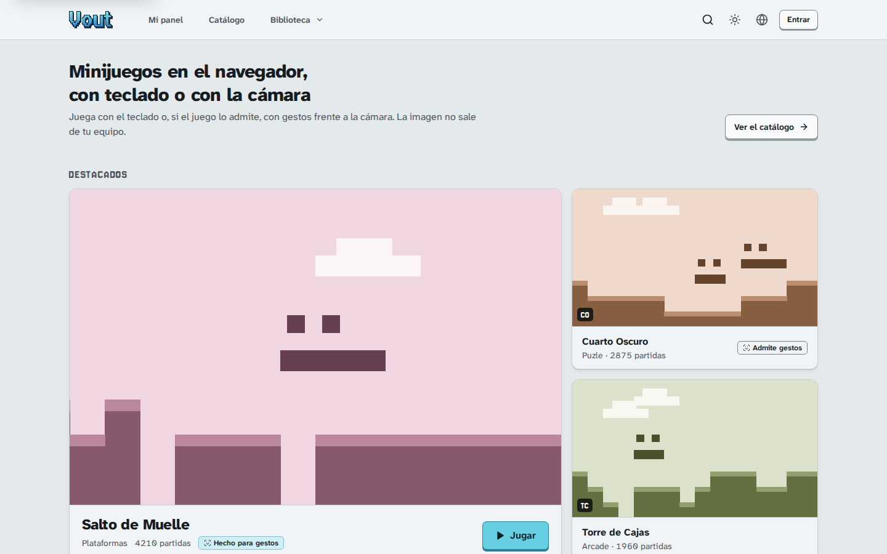
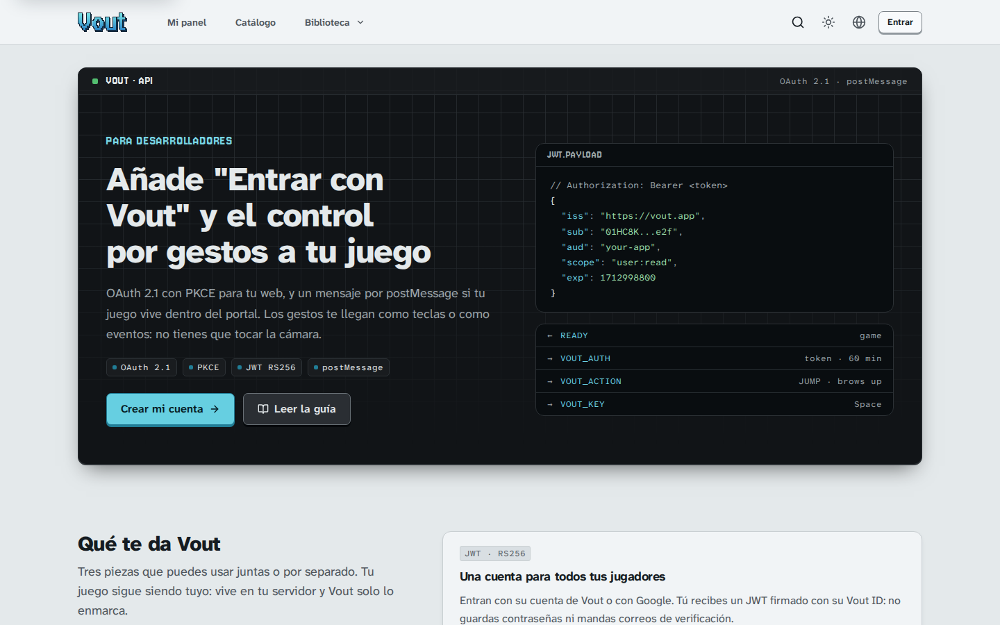
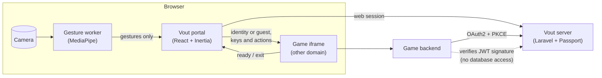

# Vout

**One account for a whole family of browser games, and a way to play them with your face.**

[Leer en español](README.es.md)



## The idea

Most web games assume you have two working hands and a keyboard. Many people don't: people with reduced mobility, people recovering from an injury, people who simply can't hold a controller for long.

Vout lets them play anyway. You turn on your webcam and your face becomes the controller. You raise your eyebrows to jump, open your mouth to duck and turn your head to move. The game receives ordinary key presses, so it doesn't even need to know a camera is involved.

Around that, Vout solves a second problem every small game studio has: accounts. Instead of each game building its own sign-up, password reset and email checks, players create **one Vout account** and use it everywhere, the way you'd use "Sign in with Google".

## Highlights

- **Hands-free play in the browser.** Real-time face tracking with no install and no plugin, and the camera image never leaves the player's device.
- **A real identity provider.** It is a standards-based OAuth2 server with signed tokens that any game can verify on its own.
- **Games from anywhere.** Third-party games keep running on their own domains. Vout embeds them and talks to them through a small, documented protocol.
- **Built to be trusted.** Accessibility is checked by automated tests, personal data is kept to a minimum and every layer is tested, from units to a real browser.

## Try it

1. Open a game whose page says you can play without an account. You don't need to sign up.
2. Press **"Face control"** and then **"Try it now"**. Your browser asks for camera access.
3. Look at the camera and raise your eyebrows. The game reacts as if you'd pressed a key.

If you sign in, the game recognizes you and keeps your progress. Your gesture settings and sensitivity are saved to your account.

## How it works

### Identity: an OAuth2 server, not just a login form

Vout is built on Laravel Passport and follows the same standards as the big identity providers:

- **Authorization Code with PKCE** for games that sign players in on their own site ("Sign in with Vout").
- **RS256-signed JWTs** with a public key set and OpenID-style discovery. Games verify tokens themselves (signature, issuer, audience, expiry) and never need access to Vout's database. This keeps the games decoupled and keeps Vout's data where it is.
- **Scoped, revocable consent.** A game only gets what the player approved, and the player can withdraw it at any time from their settings.
- Two-factor authentication, Google sign-in and email verification for the accounts themselves.

### Games in an iframe, identity over `postMessage`

Inside the portal, games run in an iframe on their own domain. Browsers increasingly block third-party cookies there, so the usual "the game reads its own session" approach doesn't work. Vout uses a handshake instead:

1. The game says it's ready (`READY`).
2. The portal checks that the message really comes from that game's registered origin and from the iframe it created.
3. The portal replies with a short-lived token (`VOUT_AUTH`) or, if the player has no account, a guest greeting (`VOUT_GUEST`).
4. Before the token expires, the portal sends a fresh one. When the session ends, the game is told why.

Tokens never travel in a URL, and the portal only ever sends messages to the origin it verified.

Each game also declares how much it needs to know about the player:

- **No account:** the game never receives the player's identity.
- **Optional account:** anyone can play; signed-in players are recognized.
- **Account required.**

The portal enforces the choice, so a game that doesn't need personal data never gets it.

### The gesture engine

- **On-device vision.** Google's [MediaPipe Face Landmarker](https://ai.google.dev/edge/mediapipe/solutions/vision/face_landmarker) runs in a **dedicated Web Worker**, so detecting gestures never steals time from the game's rendering. The model and runtime are served by Vout itself, without a third-party CDN.
- **Measured, not guessed.** The engine reports its own timings at every stage of the pipeline. On a mid-range laptop with an integrated GPU (Intel UHD 620), inference takes about **40 ms** (median) and the whole path from camera frame to detected gesture about **75 ms**, with no backlog of frames.
- **Calibrated for each player.** Gestures are measured against the player's own neutral face, with adjustable sensitivity, because faces and mobility vary a lot. A held gesture behaves like a held key.
- **A tiny SDK for game developers.** For security reasons, browsers don't let one site type into another site's page. Vout's dependency-free SDK runs inside the game and turns the portal's messages into real keyboard and mouse events. A game's existing controls work unchanged; integrating it takes two lines.

## Security and privacy by design

- **The camera image stays on the device.** Only the detected action (for example, "jump") leaves the vision worker. Vout stores numeric settings such as sensitivity, never images or facial data. This follows the guidance of Spain's data protection authority (AEPD).
- **The camera only turns on after an explicit action.** It pauses when the tab is hidden and switches off after a minute away.
- **Least privilege everywhere:** short-lived tokens, scopes, per-game consent, strict origin checks, CSRF protection and rate limiting on sensitive endpoints.
- **Minimal cookies:** only the ones the site needs to work, plus one optional preference. There are no ad trackers and no third-party analytics.

## Accessibility

Accessibility is a requirement here, not a feature:

- Automated **axe** audits run on the key pages, in light and dark mode.
- A test checks the **contrast of every color** in the theme against WCAG AA.
- The interface uses **Atkinson Hyperlegible**, a typeface the Braille Institute designed for low-vision readers. It is self-hosted, with no external font requests.
- Everything works with the keyboard and has a visible focus indicator, and the interface is available in Spanish and English.

## Quality

- **800+ PHP tests:** unit, integration and **real-browser tests** (Pest 4 + Playwright). The browser tests play stub games on a different origin, check the whole handshake and run the actual vision model against a synthetic camera.
- **~380 JavaScript tests** for the gesture engine, the classifier (using recorded gesture data) and the design system.
- Linting, formatting and the full test suite run in GitHub Actions on every push to `main`.



## Architecture



## Stack

| Layer | Technology |
| :--- | :--- |
| Backend | PHP 8.5, Laravel 13, Laravel Passport (OAuth2), Fortify, Socialite, MariaDB |
| Frontend | React 19, Inertia.js 2, TypeScript, Tailwind CSS 4, Wayfinder (type-safe routes) |
| Computer vision | MediaPipe Tasks Vision (Face Landmarker) in a Web Worker |
| Testing | Pest 4 (unit, feature and browser tests with Playwright), Bun test |
| Tooling | Docker (Laravel Sail), Bun, ESLint, Prettier, Pint, GitHub Actions |

## Running it locally

You need Docker. The project runs inside [Laravel Sail](https://laravel.com/docs/sail).

```bash
git clone https://github.com/OliverMp28/vout.git && cd vout
cp .env.example .env
docker run --rm -u "$(id -u):$(id -g)" -v "$(pwd):/var/www/html" -w /var/www/html laravelsail/php84-composer:latest composer install --ignore-platform-reqs
vendor/bin/sail up -d
vendor/bin/sail artisan key:generate
vendor/bin/sail artisan passport:keys
vendor/bin/sail artisan migrate --seed
vendor/bin/sail bun install
vendor/bin/sail bun run build
```

Then open <http://localhost> and create an account. Google sign-in is optional and needs your own OAuth credentials in `.env`. For development, `vendor/bin/sail bun run dev` reloads changes as you save.

To run the tests:

```bash
vendor/bin/sail artisan test --compact
vendor/bin/sail bun run test:js
```

## Adding a game

Any web game that can run in an iframe can join the catalog. The [integration guide](docs/integration-guide.en.md) covers "Sign in with Vout", verifying tokens, the iframe protocol and the SDK. The quickest start:

```html
<script src="https://YOUR-VOUT-DOMAIN/sdk/vout-game.js"></script>
<script>
    VoutGame.connect({
        portalOrigin: 'https://YOUR-VOUT-DOMAIN',
        onAuth(session) { /* signed-in player: send session.token to your backend */ },
        onGuest() { /* playing without an account */ },
    });
</script>
```

**Daino**, a separate project, is a game built this way. It uses Vout to sign players in on its own site and inside the portal.

## Author

Designed and built by [Oliver](https://github.com/OliverMp28): product, backend, frontend, computer vision and tests.
