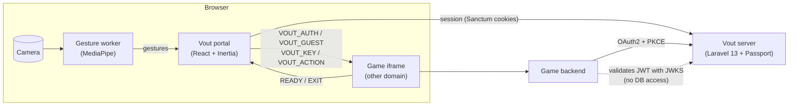

# Vout

**A single account for a family of browser games, and a way to play them with your face.**

[Leer en español](README.es.md)


Vout is three things that work together:

- **An identity provider.** You create one Vout account and use it to sign in to every game in the ecosystem. Vout is a full OAuth2 server (Authorization Code + PKCE) that issues signed JWTs, so each game checks who you are without ever touching Vout's database.
- **A game portal.** A catalog of browser games you open and play straight away, with favorites, a library and "continue playing".
- **Hands-free control.** Turn on your camera and your face becomes the controller: raise your eyebrows to jump, open your mouth to duck, turn your head to move or to steer a cursor. Detection runs entirely in your browser. The camera image never leaves your computer.

The hands-free part is the reason the project exists. Many people can't use a keyboard or a gamepad comfortably, and most web games give them no other option.

## Try it in 30 seconds

1. Open a game whose page says you can play without an account. You don't need to sign up.
2. Press **"Face control"** and then **"Try it now"**. Your browser asks for camera access.
3. Look at the camera and raise your eyebrows. The game receives it as a key press.

If you sign in, the game recognizes you and saves your progress. Your gesture settings and sensitivity are saved too.

## What's interesting under the hood

**OAuth2 / OpenID-style identity provider** (Laravel Passport)

- Authorization Code with PKCE for external games, RS256-signed JWTs with a `kid`, a public JWKS endpoint and `/.well-known/openid-configuration` discovery.
- Games validate tokens statelessly (signature, `iss`, `aud`, `exp`). They never query Vout's database.
- Per-user consent that the user can review and revoke, with scopes (`user:read`, `user:email`, `games:read`, `games:write`).
- Two-factor authentication, Google sign-in and email verification.

**Secure identity inside an iframe**

Games run on their own domains inside an iframe, and third-party cookies are increasingly blocked there. The portal and the game talk over `postMessage` (`READY` → `VOUT_AUTH` or `VOUT_GUEST`):

- Tokens never travel in a URL.
- Every message is checked against the game's registered origins, and the portal only sends to the validated origin (never `'*'`).
- The portal renews the game's token before it expires and tells the game when the session ends (`signed_out`, `revoked`, `unavailable`).
- Each game declares whether it needs an account: **none** (it never receives the player's identity), **optional** or **required**.

**A gesture engine that keeps up with the game**

- [MediaPipe Face Landmarker](https://ai.google.dev/edge/mediapipe/solutions/vision/face_landmarker) runs in a dedicated Web Worker, so detection never blocks the game's rendering. The model and WASM files are served by Vout itself, with no third-party CDN.
- Measured on a mid-range laptop (Chrome, Intel UHD 620 integrated GPU): inference p50 ≈ 40 ms, camera frame to result ≈ 75 ms, ≈ 23 frames analyzed per second from a 30 fps camera, and no frame queue building up.
- Gestures are classified against a neutral face calibrated for each player, with adjustable sensitivity. A held gesture is a held key.
- Games on another domain can't receive synthetic key events from the portal, so Vout ships a small **dependency-free SDK** (`public/sdk/vout-game.js`) that turns Vout's messages into real `keydown`/`click` events. A game's existing keyboard controls work without changes.

**Accessibility and privacy as requirements**

- Automated accessibility checks (axe) on the key pages in light and dark mode, plus a test that checks the contrast of every color token (WCAG AA).
- The [Atkinson Hyperlegible](https://www.brailleinstitute.org/freefont/) typeface, designed by the Braille Institute for low-vision readers, self-hosted.
- The camera only turns on after an explicit action, pauses when the tab is hidden and switches off after a minute away. Only numeric settings are stored, never images or facial data. This follows the guidance of Spain's data protection authority (AEPD).
- The whole interface is translated into Spanish and English.

## Architecture



## Stack

| Layer | Technology |
| :--- | :--- |
| Backend | PHP 8.5, Laravel 13, Laravel Passport (OAuth2), Fortify, Socialite, MariaDB |
| Frontend | React 19, Inertia.js 2, TypeScript, Tailwind CSS 4, Wayfinder (typed routes) |
| Computer vision | MediaPipe Tasks Vision (Face Landmarker) in a Web Worker |
| Tests | Pest 4 (unit, feature and browser tests with Playwright), Bun test |
| Tooling | Laravel Sail (Docker), Bun, ESLint, Prettier, Pint, GitHub Actions |

## Running it locally

You need Docker. The project runs inside [Laravel Sail](https://laravel.com/docs/sail).

```bash
git clone https://github.com/OliverMp28/vout.git && cd vout
cp .env.example .env
docker run --rm -u "$(id -u):$(id -g)" -v "$(pwd):/var/www/html" -w /var/www/html laravelsail/php84-composer:latest composer install --ignore-platform-reqs
vendor/bin/sail up -d
vendor/bin/sail artisan key:generate
vendor/bin/sail artisan passport:keys
vendor/bin/sail artisan migrate --seed
vendor/bin/sail bun install
vendor/bin/sail bun run build
```

Open <http://localhost> and sign in with `test@example.com` / `password`. Google sign-in needs `GOOGLE_CLIENT_ID` and `GOOGLE_CLIENT_SECRET` in `.env`.

For development, use `vendor/bin/sail bun run dev` to get hot reload.

## Tests

```bash
vendor/bin/sail artisan test --compact   # PHP: unit, feature and browser tests
vendor/bin/sail bun run test:js          # gesture engine and design tests
vendor/bin/sail bun run lint:check && vendor/bin/sail bun run format:check
```

The browser tests drive a real Chromium: they play stub games on another origin, check the full handshake, and run MediaPipe against a synthetic camera.

## Adding a game

Any web game that can run in an iframe can join the catalog. The [integration guide](docs/integration-guide.en.md) covers registering an app, signing users in with "Sign in with Vout", validating tokens, the iframe protocol and the SDK. The fastest path is two lines:

```html
<script src="https://YOUR-VOUT/sdk/vout-game.js"></script>
<script>
    VoutGame.connect({ portalOrigin: 'https://YOUR-VOUT', onAuth(session) {}, onGuest() {} });
</script>
```

Daino, a separate project, is a game that uses Vout as its identity provider, both on its own site and embedded in the portal.

## Author

Built by [Oliver](https://github.com/OliverMp28).
